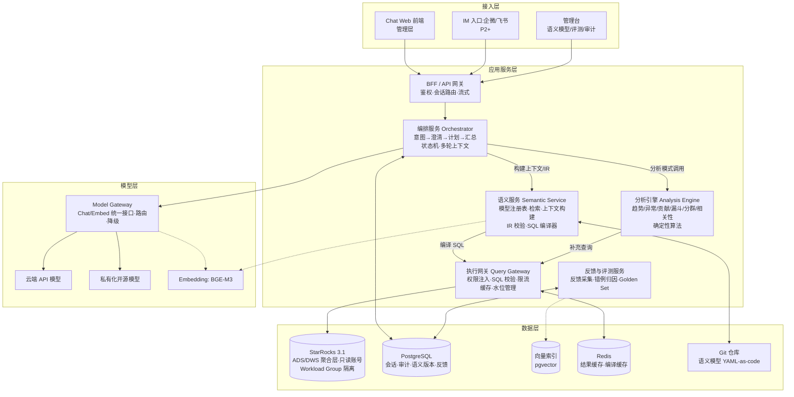
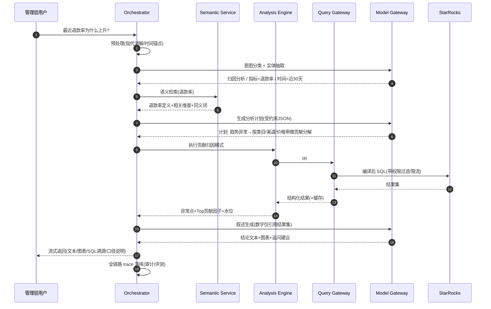

# 02 总体架构设计

---

## 1. 设计原则

| # | 原则 | 落地含义 |
|---|---|---|
| P1 | 准确率优先于覆盖面 | 宁可澄清/拒答,不给错数;每个指标先入语义层再开放提问 |
| P2 | 确定性承担口径,LLM 承担理解 | 指标公式/聚合规则/权限过滤 = 代码;LLM 只产"选什么、看哪段" |
| P3 | 可解释、可溯源 | 每个答案附:所用指标定义、时间范围、生成 SQL、数据截至时间 |
| P4 | 演进式架构 | 语义层可独立加固;模型可插拔;预留 Headless SL/IM/实时数据的演进点 |
| P5 | 轻量匹配体量 | 用户 ≤20、QPD 数百级:模块化单体 + 少量服务,拒绝过度设计 |
| P6 | 评测驱动 | 每一次 Prompt/模型/语义变更都过 Golden Set 回归 |

## 2. 产品能力分级与典型问题映射

| 能力级 | 描述 | 覆盖典型问题 | 交付阶段 |
|---|---|---|---|
| L1 问数 | 单/多指标点位查询 | ①昨天 GMV、支付订单数、客单价 | P1(MVP) |
| L2 对比与趋势 | 同环比、趋势序列、维度拆解与排名 | ②30 天销售额趋势 ③本月环比上月 ④类目下降排名 ⑤渠道转化率排名 | P1(MVP) |
| L3 归因与分群 | 异常检测、贡献度分解、漏斗、分群对比 | ⑥退款率为何上升 ⑦新老客购买行为差异 | P2 |
| L4 深度洞察 | 相关性/恒等式拆解、多步分析、周期报告 | ⑧广告加投而销售未涨的原因 | P2~P3 |

## 3. 总体架构图



## 4. 核心链路时序



## 5. 服务拆分与职责

| 服务 | 职责 | 关键接口(契约要点) | 形态 |
|---|---|---|---|
| BFF/API | 鉴权(SSO/JWT)、会话管理、SSE 流式、静态资源 | `POST /api/chat` `GET /api/sessions/{id}/messages` | 独立部署 |
| Orchestrator | 预处理、意图分类、澄清决策、查询计划、结果汇总、多轮上下文 | 内部事件流;输入 `QuestionContext`,输出 `AnswerBundle` | 独立部署(与 BFF 同进程亦可) |
| Semantic Service | YAML 加载与版本管理、同义词/向量检索、上下文切片、IR 校验、SQL 编译 | `POST /sem/search` `POST /sem/compile {IR} → {SQL, meta}` | 独立部署 |
| Analysis Engine | 8 类分析模式的确定性实现(见 04 文档) | `run(pattern, params) → AnalysisResult` | 库/模块(挂 Orchestrator) |
| Query Gateway | SQL 安全校验(AST 白名单)、权限过滤注入、Workload/超时控制、结果缓存、数据水位 | `POST /qg/execute {sql, budget} → {rows, watermark}` | 独立部署 |
| Model Gateway | Chat/Embed 统一接口、候选路由、失败降级、token 计量 | OpenAI 兼容协议 | 独立部署(轻) |
| 反馈与评测 | 反馈采集、错例归因、Golden Set 管理、批量评测 runner | `POST /feedback` `POST /eval/run` | 管理台后端 |

**Monorepo 结构(建议)**

```
bizinsight/
├── apps/web/            # Chat 前端 + 管理台(React)
├── services/
│   ├── bff/             # BFF API
│   ├── orchestrator/    # 编排 + 分析引擎模块
│   ├── semantic/        # 语义服务(含编译器,纯函数核心)
│   ├── query-gateway/   # 执行网关
│   └── model-gateway/   # 模型网关
├── semantic-models/     # 语义层 YAML(Git 管理,评审后发布)
├── eval/                # Golden Set + 评测 runner + 报告
├── deploy/              # docker-compose / K8s manifests
└── docs/
```

## 6. 关键架构决策(ADR 摘要)

| # | 决策 | 选择 | 理由与代价 |
|---|---|---|---|
| D1 | SQL 生成方式 | **LLM 产语义 IR → 确定性编译为 SQL**;自由 Text-to-SQL 仅作为白名单视图上的兜底通道 | 口径确定、可测可审计;代价:需自建编译器(约 2~3 人周) |
| D2 | 语义存储 | YAML-as-code + Git 评审 + 服务热加载 | 口径变更可追溯、可 diff、可回滚;代价:需要发布流程纪律 |
| D3 | 编排框架 | **自研轻量状态机**(受约束的 LLM 调用点),不引入重 Agent 框架 | 链路可控、易调试;代价:放弃框架生态,接受自维护 |
| D4 | 模型接入 | Model Gateway 抽象,云端 API 与私有化双轨 PoC 后定案 | 避免供应商锁定;代价:抽象层薄开发 |
| D5 | 分析能力 | 模板化分析模式库(确定性算法),而非开放推理 | 归因结论可复算、可解释;代价:覆盖依赖模式扩充 |
| D6 | 数据路径 | 只读 ADS/DWS 聚合层为主,受控明细模板为辅 | 时延可控、权限清晰;代价:依赖数仓团队补齐 ADS |
| D7 | 澄清策略 | 歧义时"默认口径 + 显式假设标注",高风险歧义才反问 | 高层体验优先;代价:答案必须带假设说明 |
| D8 | 审计与评测前置 | 全链路 trace + Golden Set 从 P1 开始建设 | 上线即有回归能力;代价:前期 10% 工时投入 |

## 7. 非功能设计

### 7.1 时延预算(目标 P50 ≤ 8s,P95 ≤ 15s)

| 环节 | 预算 | 说明 |
|---|---|---|
| 预处理+意图分类 | 0.5~1.5s | 轻量模型/规则可部分并行 |
| 语义检索+上下文构建 | <0.3s | 本地内存+向量索引,语料极小 |
| 计划生成(LLM) | 2~4s | 受约束 JSON,流式 |
| SQL 执行 | 0.5~3s | ADS 预聚合查询;超时 10s 硬限 |
| 分析计算+叙述生成(LLM) | 2~4s | 流式输出先文本后图表 |
| 首字时延 | <3s | 叙述阶段流式保障体感 |

### 7.2 容量与部署

- 并发 ≤ 5、QPD ≤ 500:应用层 **2 台 8C32G**(Nginx+BFF+Orchestrator+Semantic+Gateway 容器化)+ PostgreSQL 1 主 1 备 + Redis 1 实例;均为企业内网。
- LLM 私有化(若选):1 台 GPU(8×4090 或 2×A100 量级)支撑 ≤10 并发绰绰有余。
- HA:服务无状态可双副本;PG 每日备份;语义 YAML 在 Git 中天然多副本。**不做跨机房**。

### 7.3 可观测性

- 全链路 Trace:每次提问落 `trace` 记录(问题/意图/上下文切片/IR/SQL/结果摘要/LLM 输入输出/时延/token/反馈),支撑审计、错例归因、评测回流三件事。
- 指标:执行准确率(离线)、澄清率、拒答率、时延分位、SQL 失败率、缓存命中率;Grafana 看板 + 错误告警。

### 7.4 与既有数仓的边界

- 本系统**只读**,通过专用只读账号访问 StarRocks;不写任何业务表。
- ADS/DWS 表的生产维护属数仓团队;本平台负责提出**语义驱动的建模需求清单**(见 05 文档),并通过"数据可信标识"暴露口径风险。
