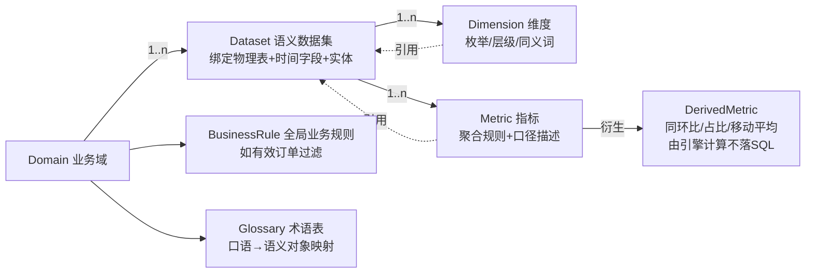

# 03 语义层设计(轻量自建 Semantic Layer)

---

## 1. 定位与边界

**Platform-native Semantic Context 的含义**:语义资产(指标口径、维度、业务规则、术语、权限)定义在本平台内、由本平台治理,并以"LLM 可读上下文"的形式原生供给推理链路;语义层同时承担"IR→SQL 确定性编译"的执行职责。

与 Headless SL( Cube/dbt MetricFlow)的关系:

| 维度 | 本方案(轻量) | Headless SL |
|---|---|---|
| 承载 | 单平台内存态注册表 + YAML 文件 | 独立服务/编译器生态 |
| 功能 | 满足问数所需子集:模型/维度/指标/规则/术语 | 全量:多引擎、多消费端、版本调度 |
| 复杂度 | 1 个模块(编译器为纯函数核心) | 独立中间件 + 学习成本 |
| 演进 | 元模型与其概念对齐,未来可导出 | — |

## 2. 语义元模型



核心对象:

| 对象 | 关键属性 | 说明 |
|---|---|---|
| `Domain` | name, desc, owner, status | 业务域:交易/商品/用户/流量/营销/售后 |
| `Dataset` | physical_table, time_field, entity, joins, partition_field, grain | 绑定 ADS 物理表;声明 join 能力与粒度 |
| `Dimension` | name, expr, type(categorical/hierarchy/time), synonyms, hierarchy, default_sort | 层级维度(类目一二三级)支持下钻 |
| `Metric` | name, expr 或 agg(+distinct_type), unit, format, description, synonyms, owners, tier(P0/P1), caveats | 口径唯一事实源;`caveats` 写入答案口径说明 |
| `DerivedMetric` | base_metric, op(yoy/mom/share/rolling_avg), params | 由分析引擎计算,不进 SQL 编译 |
| `BusinessRule` | name, condition, applies_to | 如"有效订单:pay_status=PAID AND refund_full=false" |
| `Glossary` | term → targets[], disambiguation | "营业额→GMV";歧义词标注澄清策略 |

## 3. YAML 规范与示例(节选)

```yaml
# semantic-models/trade.yaml
domain: trade
owner: 数据平台组
datasets:
  - name: ads_trade_order_di      # 日粒度交易聚合表(ADS)
    physical_table: ads.ads_trade_order_1d
    time_field: dt
    grain: day
    entity: order
    dimensions:
      - name: channel
        expr: channel_name
        synonyms: [渠道, 流量来源, 推广渠道]
      - name: category
        expr: cate_l1_name
        hierarchy: [cate_l1_name, cate_l2_name, cate_l3_name]
        synonyms: [类目, 品类, 商品类目]
      - name: user_type
        expr: user_type
        synonyms: [新老客, 用户类型]
metrics:
  - name: gmv
    display: 支付GMV
    agg: sum
    expr: pay_amount
    unit: 元
    format: "0,0.00"
    tier: P0
    synonyms: [销售额, 营业额, 成交额, GMV]
    description: 支付成功订单的应付金额合计,含运费,不含取消与全额退款
    caveats: 与"下单GMV(未支付口径)"不同;财务对账口径见 finance.gmv_fin
  - name: pay_order_cnt
    display: 支付订单数
    agg: count_distinct
    expr: order_id
    tier: P0
    synonyms: [订单量, 支付单量]
  - name: arppu                          # 客单价:二段聚合,禁止 avg(pay_amount) 误用
    display: 客单价
    agg: ratio
    numerator: { agg: sum, expr: pay_amount }
    denominator: { agg: count_distinct, expr: user_id }
    unit: 元
    tier: P0
    synonyms: [客单价, 单客产出, ARPPU]
    description: GMV / 支付买家数(去重),非订单均价
  - name: refund_rate
    display: 退款率
    agg: ratio
    numerator: { agg: sum, expr: refund_amount }
    denominator: { agg: sum, expr: pay_amount }
    unit: "%"
    tier: P0
    synonyms: [退货率, 退款占比]
  - name: buyer_cnt
    display: 支付买家数
    agg: hll_count
    expr: user_id_hll          # ADS 预建 HLL 列
    tier: P0
business_rules:
  - name: valid_order
    condition: "pay_status = 'PAID'"
    applies_to: [gmv, pay_order_cnt, arppu, buyer_cnt]
glossary:
  - term: 营业额
    targets: [trade.gmv]
  - term: 转化率
    targets: [funnel.pay_cvr, funnel.click_cvr]
    disambiguation: ask   # 命中多指标且无上下文时澄清
```

## 4. 语义检索与上下文构建

一期策略(**简化优先**,语料 = 6 域 × 30~60 语义对象,总量极小):

1. **对象召回**:查询词分词后,对 metric/dimension 的 `name+display+synonyms+description` 做关键词倒排 + 向量(BGE-M3)双路召回,RRF 融合;同义词表优先级最高(规则命中直接锁定)。
2. **域级扩展**:命中对象所属 Dataset 的全部维度 + 同域 P0 指标一并注入(保证可组合性)。
3. **上下文切片**:以紧凑 JSON/YAML 注入(LLM 可读),含指标 `description/caveats/unit`、维度枚举值(枚举成员 ≤50 全量,>50 给 Top + 提示用 filter 检索)。
4. **Token 预算**:上下文 ≤ 3K tokens;超出则按命中度截断。
5. **术语歧义**:Glossary `disambiguation: ask` 的词在无多轮上下文消解时触发澄清(D7 策略)。

## 5. 语义查询 IR(中间表示)

LLM 的唯一合法输出形态之一(JSON Schema 强约束 + function calling):

```json
{
  "query_type": "aggregate",
  "metrics": ["gmv", "pay_order_cnt", "arppu"],
  "dimensions": ["channel"],
  "time_range": { "type": "relative", "offset_days": -1, "span_days": 1 },
  "grain": "day",
  "filters": [{ "dimension": "category", "op": "in", "values": ["服饰"] }],
  "order_by": [{ "by": "gmv", "dir": "desc" }],
  "limit": 20
}
```

分析型输出为 **AnalysisPlan**(1..N 个 IR + 分析模式声明),见 04 文档。

**校验清单(编译前)**:指标/维度存在且属于同 Dataset(或声明了合法 join);比率指标不携带分母维度冲突;时间范围合法(不超过 T-1);filter 值走维度枚举校验;limit ≤ 200。校验失败 → 错误消息回喂 LLM 重试(≤2 次)→ 仍失败转澄清/拒答。

## 6. 编译器:IR → SQL(确定性)

### 6.1 聚合规则表(核心正确性保障)

| 指标类型 | 编译规则 | 示例 |
|---|---|---|
| sum/count | `SUM(expr)` / `COUNT(expr)` | `SUM(pay_amount)` |
| count_distinct | 优先预建 `BITMAP_UNION_COUNT`;明细兜底 `COUNT(DISTINCT ...)` | 支付订单数 |
| hll_count | `HLL_UNION_AGG(hll_col)` | 支付买家数 |
| **ratio(比率)** | **两段聚合**:`SUM(num)/NULLIF(SUM(den),0)` 外层包裹,严禁先比值再平均 | 客单价 = `SUM(pay_amount)/HLL_UNION_AGG(user_id_hll)` |
| 混合查询 | 同一 IR 内指标必须同粒度可聚合;比率与加法混查时统一在外层完成除法 | — |

### 6.2 编译流程

`IR 校验 → 解析指标表达式 → 注入 BusinessRule 过滤 → 注入权限过滤(见 §8)→ 解析时间(相对→[dt_start, dt_end])→ 维度 GROUP BY(+层级下钻展开)→ 拼装 SELECT/ORDER/LIMIT → 输出 SQL + 元数据(口径说明/数据集/水位要求)`

### 6.3 编译示例

问:"昨天各渠道的客单价和 GMV,按 GMV 降序"

```sql
SELECT
  channel_name                                        AS channel,
  SUM(pay_amount)                                     AS gmv,
  SUM(pay_amount) / NULLIF(HLL_UNION_AGG(user_id_hll), 0) AS arppu
FROM ads.ads_trade_order_1d
WHERE dt = '2026-11-06'              -- 由 relative(-1) 解析
  AND pay_status = 'PAID'            -- BusinessRule: valid_order
  /* + 权限过滤注入点 */
GROUP BY channel_name
ORDER BY gmv DESC
LIMIT 20;
```

返回元数据同步携带:`gmv=支付GMV(口径描述)`、`arppu=GMV/支付买家数`、`数据截至 T-1 06:30`,供答案层渲染口径脚注。

## 7. 口径治理流程(项目最大风险的对冲)

1. **P0 阶段:指标字典工作坊**——与数据团队/业务方逐条签收 30~50 个核心指标(定义、公式、过滤条件、与财务口径差异),产出 `semantic-models/*.yaml` v1。
2. **变更流程**:YAML 修改走 MR 评审(数据团队 + 平台 owner 双签)→ 合并后热加载 → 自动生成"口径变更公告"推送管理台。
3. **单一事实源**:平台 UI 中展示的口径、答案中的口径脚注、评测期望值,三者同源于 YAML;**禁止**在 Prompt/代码中硬编码口径。
4. **口径体检(P2)**:每月自动比对语义指标与财务报表值(抽样月度),偏差 >0.5% 告警。

## 8. 权限注入点

编译期按用户身份注入谓词(行级)与列裁剪(列级):

- 行级:用户 profile 携带 scope 规则(如按品牌线/BU),编译器在 `WHERE` 追加 `AND brand_id IN (...)`;管理层默认全量,规则为空即可。
- 列级:语义对象标注 `acl`,未授权指标/维度在检索阶段即被过滤(LLM 看不到即不会问出),双重保险于 Gateway 校验。

详见 07 文档。

## 9. 管理台功能清单(P2 交付)

- 语义模型可视化编辑 + diff 预览 + 发布/回滚(操作 Git 仓库)
- 指标口径检索页(管理层可查"GMV 是什么口径")
- Golden Set 管理、批量评测触发与报告
- 审计查询(trace 全文检索)、反馈与错例看板
