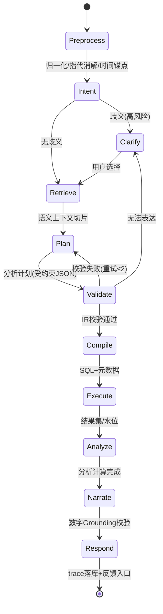

# 04 查询与分析引擎设计

> 本模块是"AI 经营分析助手"与"Text-to-SQL 工具"的分水岭:在语义层之上,内建**确定性的分析模式库**,由编排状态机调度。

---

## 1. 编排状态机

| 阶段 | 输入 | 处理 | 失败处理 |
|---|---|---|---|
| Preprocess | 原始问题+会话历史 | 指代消解("它/该类目")、时间锚定(以数据水位 T-1 为"今天"基准)、归一化 | — |
| Intent | 归一化问题 | LLM 分类:问数/对比/趋势/拆解排名/归因/漏斗/分群/相关性/超范围/闲聊 | 低置信度→澄清 |
| Retrieve | 意图+实体 | 语义服务双路召回,构建上下文切片 | 无命中→拒答+推荐问法 |
| Plan | 上下文+意图 | LLM 产出 AnalysisPlan(JSON Schema 约束) | 校验失败回喂重试 |
| Validate/Compile | Plan | IR 校验→SQL 编译 | 见 03 文档 |
| Execute | SQL | 权限/限流/缓存,查 StarRocks | 超时降级:提示缩小范围 |
| Analyze | 结果集 | 分析模式计算(见 §3) | 数据不足→如实说明 |
| Narrate | 结果+分析产物 | LLM 叙述,数字仅允许引用结果集 | Grounding 校验失败→重生成 |
| Respond | 全部产物 | 文本+图表+SQL溯源+口径脚注+追问建议 | — |

## 2. LLM 调用点与输出契约

| 调用点 | 输出约束 | 说明 |
|---|---|---|
| 意图分类 | enum + 实体字段 | 可与 Plan 合并为一次调用 |
| 计划生成 | `AnalysisPlan` JSON Schema | 见 §3;function calling 强约束 |
| 叙述生成 | 文本+图表 spec | 数字 grounding 校验:抽取答案中的数值,必须逐一存在于结果集/分析产物(容差 0.5%),否则重生成 |
| 澄清话术 | 固定模板+选项 | 不走自由生成 |

Prompt 结构(每调用点固定骨架):`角色与硬规则(反幻觉/口径引用)→ 语义上下文切片 → 会话摘要 → 输出 JSON Schema → 2~3 个 Golden Few-shot`。Few-shot 从 Golden Set 中按意图检索注入(P2 起自动化)。

## 3. 分析模式库(确定性算法)

> 原则:**计算可复算、结论可解释**;每个模式输出固定结构(指标、输入范围、方法、发现列表),叙述阶段只做语言包装。

| # | 模式 | 触发(意图) | 查询计划 | 核心算法 | 输出 |
|---|---|---|---|---|---|
| M1 | 点位查询 | 问数 | 1×IR | 直接结果 | 数值卡+口径脚注 |
| M2 | 趋势分析 | 趋势 | 日序列 IR | 斜率(线性拟合)、波动率、环比序列、7日移动平均 | 折线图+趋势描述 |
| M3 | 同环比对比 | 对比 | 当期+基期 2×IR | 双值差/差率,节假日日历标注(春节错位提示) | 对比卡 |
| M4 | 拆解排名 | 拆解排名 | 当期+基期 按维度 2×IR | 变化额排名 + 变化贡献占比 | 条形图+排名表 |
| M5 | 贡献归因 | 归因 | 趋势序列 + 逐维度分解 IR 序列 | 见 §3.1 | 异常点+Top贡献因子瀑布图 |
| M6 | 漏斗转化 | 漏斗/转化率 | 漏斗各步 1×IR(或专用漏斗表) | 步进转化率+分维度漏斗 | 漏斗图 |
| M7 | 分群对比 | 分群 | 分群×指标 2×IR(新老客由语义层标签维度实现) | 分群画像差值/比率对照表 | 双柱对比 |
| M8 | 相关性/恒等式拆解 | 相关性 | 恒等式因子序列 + 相关扫描 IR | 见 §3.2 | 因子分解+相关系数+提示语 |

### 3.1 贡献归因(M5)——回答"退款率为什么上升"

- **加法指标**(GMV、订单数):对维度 d 的成员 i,贡献度 `C_i = (m_i,t1 − m_i,t0)`,归一化为占整体变化量比例;输出瀑布图。
- **比率指标**(退款率 = 退款金额/支付金额):两段分解——
  - 分子效应:`Σ refund_i,t1/pay_i,t1 − Σ refund_i,t1/pay_i,t0`(量结构不变时的退款影响)
  - 分母效应:`Σ refund_i,t1/pay_i,t0 − Σ refund_i,t0/pay_i,t0`(规模影响)
  - 成员贡献:对每个维度成员给出 `Δr_i` 及占比;跨维度循环(类目→渠道→价格带→新老客),各维度贡献独立呈现并标注**不可加和**(避免重复计算误导)。
- **异常点检测**:对近 90 天日序列,以滚动中位数 ± k·MAD 判定异常,确定"从哪天开始上升"及最近拐点。
- 输出必含免责说明:"以上为统计归因,非因果结论"。

### 3.2 恒等式拆解 + 相关扫描(M8)——回答"广告加投但销售未涨"

1. **恒等式分解(确定性,首选)**:`GMV = UV × 支付转化率 × 客单价`。对近 30 天逐日取三因子序列,计算各因子对 GMV 变化的贡献(对数分解法),定位"掉链子"的因子。
2. **漏斗衔接**:若转化率下降,自动下钻渠道×漏斗(M6),给出哪个渠道拉低转化。
3. **相关扫描**:广告消耗 vs GMV/UV 的时序相关(同期与滞后 1~7 天,周聚合),明确标注"相关非因果,需结合投放明细验证"。
4. 输出:因子贡献瀑布 + 排查建议清单(如"渠道 A 转化率环比 -3.2pp,建议核查落地页与人群定向")。

## 4. 八个典型问题走查(验收基线)

| # | 问题 | 意图 | 模式 | 关键点 |
|---|---|---|---|---|
| Q1 | 昨天的 GMV、支付订单数、客单价? | 问数 | M1 | 多指标单 IR;客单价为比率指标两段聚合 |
| Q2 | 最近 30 天销售额趋势? | 趋势 | M2 | "销售额"→GMV 同义词命中;7 日均线+斜率 |
| Q3 | 本月 GMV 比上月? | 对比 | M3 | 月粒度对齐;进行中月份提示"未完月" |
| Q4 | 哪些类目销售额下降最明显? | 拆解排名 | M4 | 当期/基期默认近 30 天 vs 前 30 天;变化额+贡献占比 |
| Q5 | 哪个渠道支付转化率最高? | 拆解排名 | M1+M4 | 比率指标排名;低流量渠道显著性提示 |
| Q6 | 最近退款率为什么上升? | 归因 | M5 | 异常检测定起点;比率两段分解;跨维度循环 |
| Q7 | 新客和老客购买行为区别? | 分群 | M7 | `user_type` 语义维度;对比 AOV/频次/类目结构 |
| Q8 | 广告投入增加但销售未涨,可能原因? | 相关性 | M8 | 恒等式分解定因子;渠道漏斗下钻;相关扫描 |

## 5. 多轮对话与下钻

**上下文继承规则**(会话状态保存"最后一次查询主题"对象):

| 用户输入特征 | 改写策略 |
|---|---|
| "按渠道拆分看看" | 继承指标/时间范围,替换/追加维度 |
| "那 10 月呢" | 继承指标+维度,替换时间 |
| "只看美妆" | 继承全部,追加 filter |
| "为什么" | 继承主题,升级为 M5 归因模式 |
| 新话题 | 显式切换主题 |

- 继承项在答案中**显式回显**("仍按【近 30 天/支付GMV】口径")避免用户误解。
- 多轮上下文以"主题摘要(结构化)+ 最近 3 轮原文"注入 LLM,防止长历史稀释。
- 会话深度 >10 轮提示"开始新话题"。

## 6. 澄清与拒答策略

| 情形 | 策略 |
|---|---|
| 术语歧义(转化率/退款率多口径) | 高风险:反问选项("指支付转化率还是点击转化率?");低风险:采用 P0 默认口径+答案标注假设 |
| 时间歧义("最近") | 默认近 30 天并标注;有会话时间上下文则继承 |
| 指标未入语义层 | 坦诚拒答:"该指标尚未接入问数范围"+推荐问法+一键申请接入 |
| 数据未就绪(水位未到) | 说明数据截至时间,给截至日的答案 |
| 查询范围过大被限流 | 建议缩小时间范围/维度,不静默失败 |

**拒答质量是管理层信任的生命线**:错答一次的代价远高于拒答十次。

## 7. 叙述生成与可视化

- **数字 Grounding**:叙述中每个数字必须来自执行结果集/分析产物(程序化校验,见 §2);禁止 LLM 补充任何外部数值。
- 结论句式约束:先答结论 → 再给关键依据(2~4 条)→ 口径与时间脚注 → 追问建议。
- 图表规则表:趋势→折线;拆解排名→条形;构成→瀑布/堆叠;漏斗→漏斗图;单值→数值卡。图表 spec 由编排层按模式**确定性生成**(不经 LLM),LLM 只写文字。
- 追问建议:由模式固定生成 3 条(如 M5 后建议"看类目明细""对比上月""查渠道转化")。

## 8. Agent 化演进边界(P3+)

- P1/P2 链路是**受约束流水线**(状态机),非自由 Agent 循环——为准确率与可审计性让路。
- P3 起开放"深度分析"工具循环(semantic_query / contribution / funnel / correlation 作为 tools,设最大步数 6、预算上限),仅对白名单场景(周报草稿、专项排查)开放,产物需标注"自动分析草稿"。
