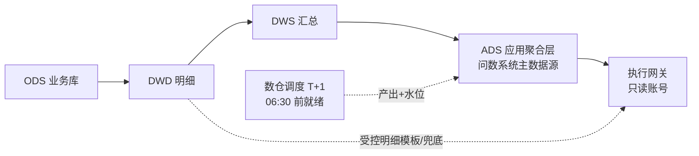

# 05 数据与性能方案(StarRocks 3.1)

---

## 1. 数据链路与访问边界



- **访问边界**:一期 90% 查询落在 ADS 日粒度聚合表;仅白名单场景(如 P3 明细下钻)经受控 SQL 模板访问 DWD,且限时长、限量。
- **水位管理**:数仓调度完成后写 `bi_etl_watermark`(域级,如 trade→2026-11-06);执行网关拒绝水位外的分区查询,答案层展示"数据截至"。
- **实时性演进**:管理层问数 T+1 为主即可;P3 可选为 GMV 等 3~5 个 P0 指标建 15 分钟增量链路(StarRocks 主键表微批导入或直连实时 DWS 表)。

## 2. ADS 建模规范(对数仓团队的需求清单)

### 2.1 核心表清单(P1 需就绪,粒度均为日)

| 表 | 内容 | 关键维度 | 关键指标列 |
|---|---|---|---|
| `ads_trade_order_1d` | 交易订单聚合 | dt, channel, cate_l1/l2/l3, brand, user_type, region, price_band, pay_status, refund_flag | pay_amount, order_cnt, user_id_hll, refund_amount, order_cnt_hll(order_id bitmap) |
| `ads_user_profile_1d` | 用户分域日聚合 | dt, user_type, channel, region | buyer_cnt_hll, new_user_cnt, pay_user_cnt_hll, aov 相关金额 |
| `ads_traffic_funnel_1d` | 流量与漏斗 | dt, channel, page, device | pv, uv_hll, click_cnt, cart_cnt, order_submit_cnt, pay_cnt |
| `ads_marketing_spend_1d` | 广告投放 | dt, channel, campaign_type | cost, impression, click |
| `ads_after_sales_1d` | 售后 | dt, cate_l1, reason, channel | refund_order_cnt, refund_amount, refund_pass_cnt |

### 2.2 表设计规范

- **分区**:按 `dt` 日分区;动态分区保留 ≥ 180 天(问数常问近 30/90 天)。
- **分桶**:高频维度之一(如 channel)哈希分桶 10~32 桶,与语义查询 GROUP BY 前缀对齐,促进本地聚合。
- **排序键**:`(dt, channel, cate_l1, ...)` 与最高频过滤/聚合路径一致。
- **去重指标预聚合**:`user_id → HLL(HLL_UNION 兼容)`、`order_id → BITMAP(BITMAP_UNION)` 列,查询端 `HLL_UNION_AGG / BITMAP_UNION_COUNT` 秒级返回;ADS 同时保留 `COUNT(DISTINCT)` 明细兜底列的语义映射。
- **比率指标不预算**:只存分子/分母列(如 refund_amount、pay_amount),比率由编译器两段聚合计算,**避免预算比率后再聚合的经典错误**。
- **物化视图补充**:若某 ADS 表暂缺,可用 StarRocks 3.1 异步物化视图基于 DWD/DWS 构建并透明改写,作为过渡(P3 前回收为正式 ADS 表)。

## 3. 查询治理(保护生产数仓)

```sql
-- Workload Group:问数专用资源组(3.1 支持)
CREATE RESOURCE GROUP rg_bi_chat
TO (query_type IN ('select'))
WITH (
  cpu_core_percent = 20, mem_limit = 20%,
  max_concurrency = 10, max_queue_size = 20, queue_timeout = 5000
);
```

- **专用只读账号** `bi_chat_ro`:仅授予 ADS 库 SELECT;DWD 白名单表单独授权。
- **会话级硬限**:`query_timeout = 10s`、`max_scan_rows/bytes` 上限、返回行数 ≤ 200(编译器强制 LIMIT)。
- **SQL 安全校验**(执行网关):AST 解析,仅允许 `SELECT`;禁多语句/注释注入/危险函数;表名白名单=语义层注册的物理表;强制含 `dt` 分区谓词(防全表扫描)。
- **大查询拦截**:EXPLAIN 估算扫描分区数 > 阈值(如 180 分区)直接拒绝并引导缩范围。

## 4. 缓存设计

| 层 | Key | TTL/失效 | 说明 |
|---|---|---|---|
| 结果缓存 | hash(IR+权限scope+语义版本) | 随水位失效(按域) | T+1 场景当日"昨天/本月"类问题命中率高 |
| 编译缓存 | hash(IR) | 语义版本失效 | 跳过编译开销 |
| 语义上下文 | — | 内存注册表 | 语料极小,进程内存即可 |

缓存结果附带水印时间,答案层必须渲染。

## 5. 数据质量与可信标识

- **DQC 规则**(数仓侧产出、平台消费):P0 指标日环比波动 >±40%、水位迟到、分子>分母、枚举维度空值率超标 → 告警并打标。
- 答案头部渲染:数据截至时间 + 可信标识(正常/疑似异常+说明);异常日数据在答案中提示"受 X 影响,建议结合业务背景解读"。
- 评测 Golden Set 的期望值以数仓核验值为准,DQC 异常期题目标记"待数据修复"。

## 6. 性能目标与压测计划

| 项 | 目标 | 验证方式 |
|---|---|---|
| ADS 聚合查询 | P50 < 1s,P95 < 3s | Golden Set 全量回放(真实库) |
| 端到端首字 | P50 < 3s,P95 < 10s | 全链路压测(模拟 5 并发) |
| 端到端完成 | P95 < 15s | 同上 |
| 明细兜底模板 | P95 < 5s(限 90 天内) | 模板回放 |

压测在 P1 第 7~8 周执行;不达标优先调 ADS 分桶/排序键与缓存策略,**禁止**靠加并发或放宽限流达标。

## 7. StarRocks 版本升级评估(可选,P3 立项)

| 项 | 3.1(现状) | 3.4+ 收益 | 评估 |
|---|---|---|---|
| MV 透明改写 | 基础可用 | GROUP BY 下推、改写增强 | 收益:可减少自建 ADS 表数量;风险:升级回归成本 |
| 预聚合能力 | 聚合表+同步 MV | 同步/异步 MV 均支持 | 锦上添花 |
| AI 生态集成 | — | 官方对 AI 场景的持续增强 | 远期关注 |

**建议**:一期锁定 3.1;若压测或 MV 过渡方案遇到改写限制,再评估升级(预计 1~2 人周含回归)。
