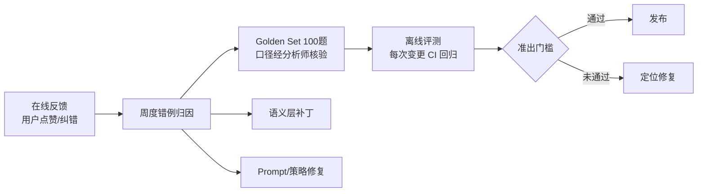

# 06 评测与运营体系

> 原则:**准确率是测出来的,不是调出来的**。Golden Set 是本项目的固定资产,所有 Prompt/模型/语义层变更一律过回归。

---

## 1. 体系总览

## 2. Golden Set 构建(P0 阶段,100 题)

### 2.1 题目分布

| 维度 | 覆盖 |
|---|---|
| 问题类型(× 8 类典型问题) | 问数 25 / 趋势 12 / 同环比 12 / 拆解排名 12 / 归因 10 / 漏斗 8 / 分群 8 / 相关性 5 / 澄清与拒答用例 8 |
| 业务域 | 交易/商品/用户/流量/营销/售后 均覆盖,P0 指标全覆盖 |
| 语言形态 | 标准问法、口语化、含指代(多轮)、歧义问法、超范围问法 |
| 时间形态 | 昨天/最近 N 天/本月/环比/指定日期区间/节假日邻域 |

### 2.2 标注规范

- 每题:问题 → 意图标签 → 期望结果(由分析师用核验过的 SQL 从真实库跑出,存快照值)→ 期望答案要点(结论+口径脚注要求)→ 澄清/拒答用例标注"正确行为"。
- 期望值随数仓快照版本冻结(评测跑在冻结分区上,保证可复现);数仓口径变更时同步更新。
- 维护:P1 结束 100 题;此后每月从线上真实提问中沉淀 10~20 题入集。

## 3. 离线评测指标

| 指标 | 定义 | M1 门槛 | M2 门槛 | M3 门槛 |
|---|---|---|---|---|
| 执行准确率 | IR 合法且执行结果与期望值一致(容差 0.5%) | top-100 ≥ 85% | ≥ 90% | ≥ 95%(top-100) |
| 澄清合理率 | 歧义题正确触发澄清且选项正确 | ≥ 70% | ≥ 85% | ≥ 90% |
| 正确拒答率 | 超范围/未接入指标正确拒答 | ≥ 80% | ≥ 90% | ≥ 95% |
| 数字幻觉率 | 答案中出现结果集之外的数字(程序化检测) | ≤ 2% | ≤ 1% | ≈0 |
| 答案质量 | 人工 rubric 5 分制(结论/依据/口径/可读性),抽样 30 题 | ≥ 3.5 | ≥ 4.0 | ≥ 4.2 |
| 时延 | 端到端 P95 | < 20s | < 15s | < 12s |

- **评测 runner**:批量执行 → 结果比对 → 生成 HTML 报告(逐题通过/失败+失败原因分类);CI 集成,语义 YAML/Prompt/模型任一变更触发。
- **失败归因五分类**:语义缺失(缺指标/维度/同义词)、IR 错误(选错对象)、编译错误(编译器 bug)、数据问题(口径/水位)、叙述错误(数字对但话错)——归因直接决定修复路径。

## 4. 在线反馈闭环

- **反馈入口**:每条答案 👍/👎 + 可选纠错说明;👎 自动附带 trace 引用。
- **错例周会**(30 分钟/周,数据团队+平台):triage 本周错例 → 五分类 → 修复项入 backlog(语义补丁优先级最高)。
- **指标看板**:周活跃用户、日均提问数、👍率、澄清率、拒答率、P95 时延、缓存命中率。
- **信任机制**:管理层用户少,采用"每周错例通报 + 修复跟踪"而非泛泛的满意度调查;连续两周 👍率 ≥ 85% 视为通过试用观察期。

## 5. 迭代机制

| 变更类型 | 流程 |
|---|---|
| 语义层补丁(加指标/同义词) | MR 评审 + 相关题目回归 → 热加载 |
| Prompt/策略变更 | MR + 全量 Golden Set 回归,任一指标回退 >2pp 需复盘 |
| 模型升级/切换 | 全量回归 + 30 题人工 rubric 抽样,双门槛通过后灰度 1 周 |
| 数仓口径变更 | 触发"语义变更公告"+ Golden Set 期望值更新 + 回归 |

## 6. 运营推广

- **试用计划**:M1 起 3~5 名数据团队/运营先行内测(错例富矿);M2 起管理层全量试用,配备"问法引导卡"(常用问法 20 条)。
- **引导设计**:首屏展示推荐问法与已接入指标清单(管理台可维护),让用户清楚"能问什么"。
- **培训**:1 次 45 分钟培训(问法技巧+口径查询+反馈渠道);管理台内置口径字典查询页。
- **汇报机制**:向项目发起方双周同步准确率/使用量/Top 错例与修复进展。
